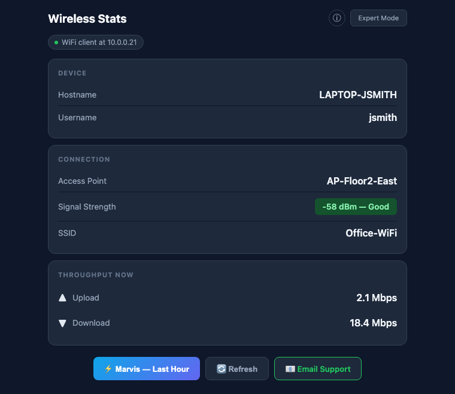
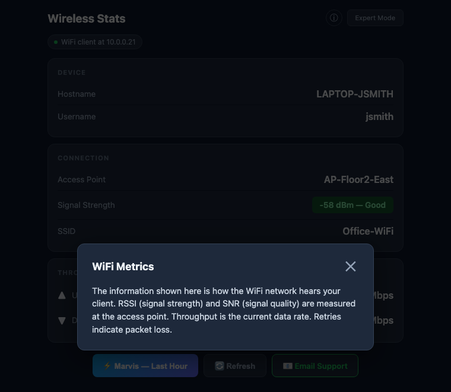
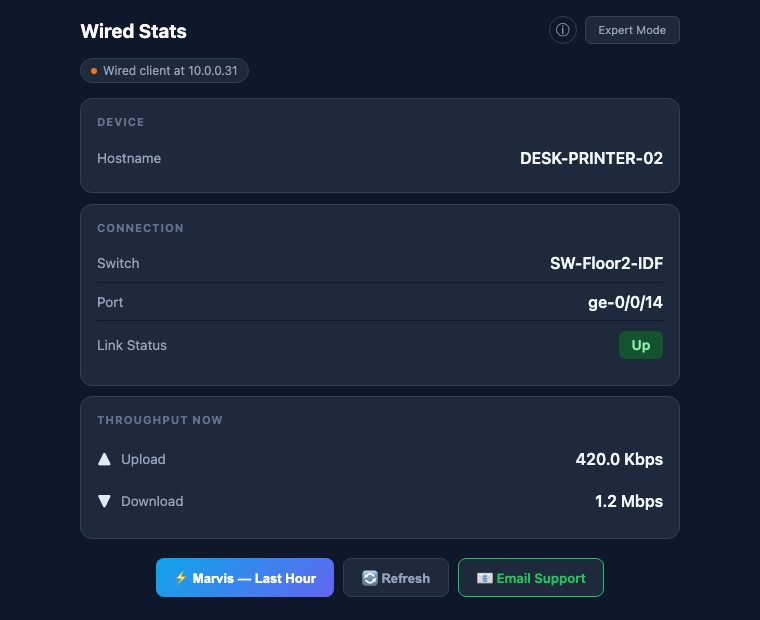
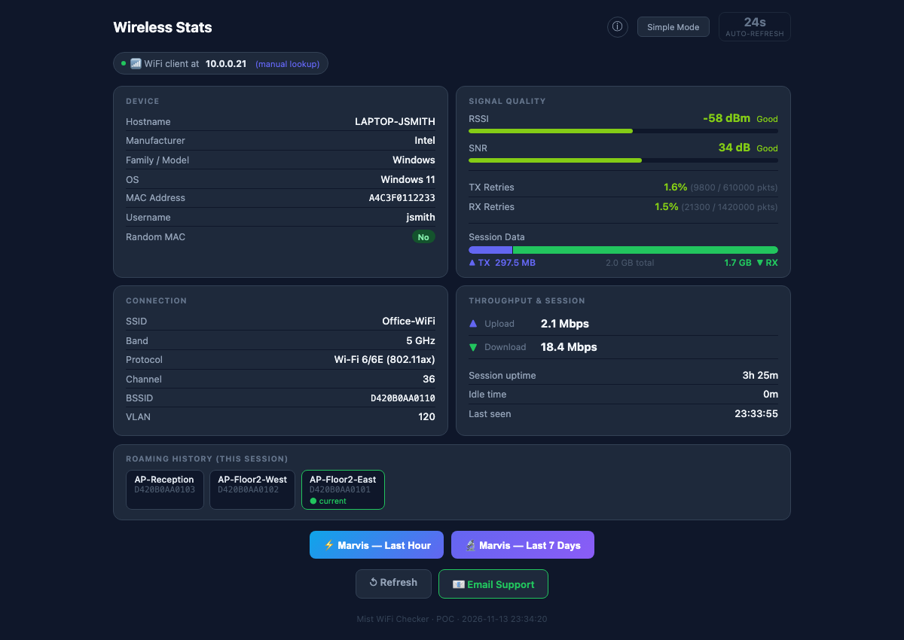
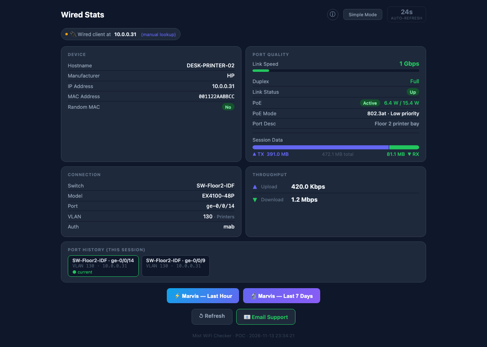
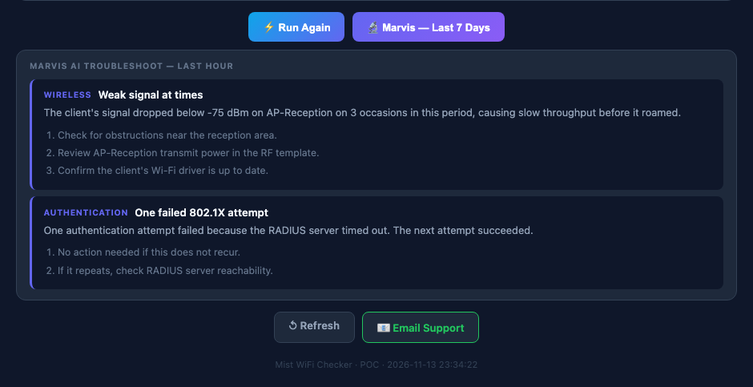
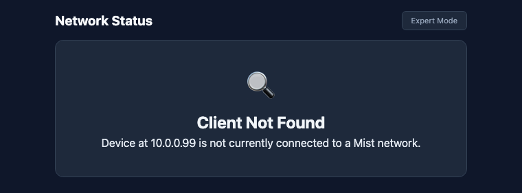
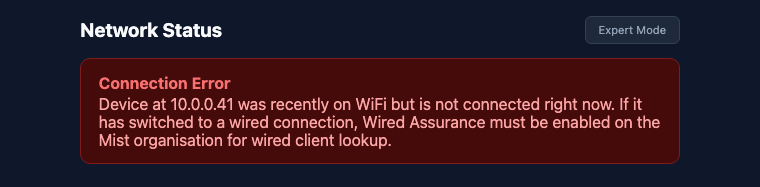

# Mist WiFi Checker: User Guide

Mist WiFi Checker is a web page that shows how the network sees **your** device right now: which access point or switch port you're on, how strong your signal is, and how fast data is moving. It can also ask Marvis, Mist's AI assistant, to look for problems with your connection.

> The screens in this guide use sample data. Names, addresses and numbers on your network will be different.

## Contents

1. [Opening the checker](#1-opening-the-checker)
2. [Simple mode: Wi-Fi](#2-simple-mode-wi-fi)
3. [Simple mode: wired](#3-simple-mode-wired)
4. [What the numbers mean](#4-what-the-numbers-mean)
5. [Expert mode](#5-expert-mode)
6. [Asking Marvis to troubleshoot](#6-asking-marvis-to-troubleshoot)
7. [Emailing support](#7-emailing-support)
8. [When your device isn't found](#8-when-your-device-isnt-found)
9. [Quick reference](#9-quick-reference)

## 1. Opening the checker

Open the checker's address in any browser on the device you want to check. Your network team will give you the address, for example `http://172.16.0.11/`.

You don't need to log in or type anything. The checker recognises your device from the address it connects from, then looks it up in Mist.

> **Use the device you want to check.** If you open the page over a VPN, or from a different device, the checker sees that connection instead of yours.

## 2. Simple mode: Wi-Fi

When your device is on Wi-Fi, the checker opens in simple mode and shows **Wireless Stats**.

| Section | What it shows |
|---|---|
| **Device** | Your device's name and, if you signed in to the Wi-Fi, your username. |
| **Connection** | The access point you're connected to, your signal strength, and the Wi-Fi network name (SSID). |
| **Throughput now** | How fast data is moving right now, up from your device and down to it. |

The signal strength badge is coloured so you can read it at a glance: green for Excellent or Good, amber for Fair, red for Poor.

Select **ⓘ** at the top for a short explanation of what the network is measuring.

## 3. Simple mode: wired

When your device is plugged in with a network cable, the checker shows **Wired Stats** instead.

| Section | What it shows |
|---|---|
| **Device** | Your device's name. |
| **Connection** | The switch and port your cable is plugged into, and whether the link is up. |
| **Throughput now** | How fast data is moving right now through that port. |

If you report a cabling problem, the switch and port name tell your network team exactly where to look.

## 4. What the numbers mean

| Measure | What it means | Good | Worth reporting |
|---|---|---|---|
| **Signal strength (RSSI)** | How loudly the access point hears your device, in dBm. Closer to 0 is stronger. | -67 dBm or better (-50 or better is Excellent) | Weaker than -80 dBm (Poor) |
| **Signal quality (SNR)** | How far your signal stands out above background noise, in dB. Higher is better. | 25 dB or more (40 or more is Excellent) | Below 10 dB (Poor) |
| **Retries** | The share of data that had to be sent again. | Under 5% | Over 10% |
| **Upload / download** | Data moving right now. It's low when you aren't doing anything, which is normal. | n/a | n/a |
| **Link speed (wired)** | The speed the port and your device agreed on. | 1 Gbps or more | 100 Mbps or less on a modern PC |

If your signal is weak, moving closer to an access point or away from thick walls and metal usually helps.

## 5. Expert mode

Select **Expert Mode** at the top right for full detail. Select **Simple Mode** to go back.

Expert mode adds:

- **Device:** manufacturer, operating system, MAC address, and whether the device uses a random (private) MAC address.
- **Signal quality:** RSSI and SNR bars, retry rates, and how much data you've sent and received this session.
- **Connection:** band (2.4, 5 or 6 GHz), Wi-Fi generation, channel, BSSID and VLAN.
- **Throughput and session:** current speeds, how long you've been connected, and when the network last heard from your device.
- **Roaming history:** each access point your device has used this session. The current one is marked **current**.

For a wired device, expert mode shows the port's speed and duplex, PoE (power over Ethernet) status and power draw, VLAN, any port errors, and the ports the device has used before.

Expert mode refreshes itself every 30 seconds. Select the **auto-refresh** counter at the top right to pause or resume it.

## 6. Asking Marvis to troubleshoot

Marvis looks through Mist's records for your device and explains any problems it finds, with steps to fix them.

- **Marvis — Last Hour** checks the past hour. Use it for a problem happening now. It's available in both modes.
- **Marvis — Last 7 Days** checks the past week. Use it for a problem that comes and goes. It's available in expert mode.

Each finding shows a category (such as Wireless or Authentication), a short summary, what happened, and numbered recommendations. If Marvis finds nothing, it says **No issues detected by Marvis for this client**.

Auto-refresh pauses while Marvis results are open, so they stay on screen. Marvis needs a Marvis subscription on your Mist organisation. Without one, the checker shows a message saying so.

## 7. Emailing support

Select **Email Support** to open a new email to your help desk in your email app. It's already filled in with your device's details, connection, signal readings and the time, so support has what they need. Add a line describing the problem, then send it.

The button only appears if your network team has set up a support address.

## 8. When your device isn't found

**Client Not Found** means Mist doesn't currently see a device at your address.

Common reasons:

- You're on a VPN, or on a network that Mist doesn't manage, such as a mobile hotspot or home Wi-Fi.
- Your device has only just connected. Wait a minute, then select **Refresh**.

If your device was recently on Wi-Fi but isn't now, you'll see this message instead:

If you've moved to a network cable, Mist needs Wired Assurance turned on to find wired devices. Ask your network team if this keeps happening.

## 9. Quick reference

| To... | Do this |
|---|---|
| Check your connection | Open the checker address on the device you're checking |
| See full detail | Select **Expert Mode** |
| Get the latest readings | Select **Refresh** |
| Pause updates (expert mode) | Select the **auto-refresh** counter |
| Find out what's wrong | Select **Marvis — Last Hour**, or **Marvis — Last 7 Days** for an on-and-off problem |
| Report a problem | Select **Email Support**, describe the problem, and send it |
| Check another device (network team) | Add its IP address to the address, for example `/expert/10.0.0.21`. The page shows **manual lookup**. |
